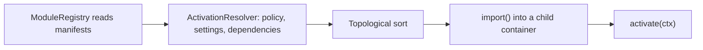
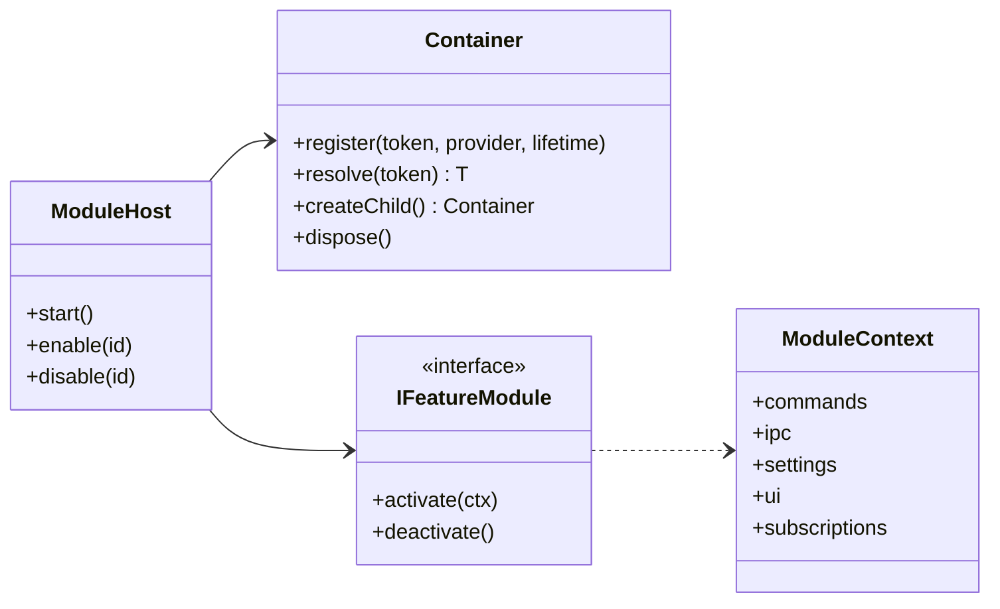

# Module system

> **Status:** approved design, not yet implemented. This page describes how the code is designed to be organized and will be updated as the implementation lands.

Astela is designed as a microkernel with feature modules. A small kernel in the browser process provides the shared infrastructure, and every feature, from workspaces to the theme editor, is a module on top of it. A disabled module is never imported, so it costs neither start-up time nor memory. This is how Astela is meant to stay lean as features are added (see [principles.md](principles.md)).

The decision records are ADR 0006 (dependency injection container) and ADR 0010 (module system and lazy loading); see the [decision record index](../adr/README.md).

## Kernel responsibilities

The kernel is the part of the browser process that is always present. It is designed to provide:

- the dependency injection container described under [Dependency injection](#dependency-injection),
- the module host, which loads, activates and deactivates modules,
- a typed event bus for domain events such as `TabActivated` and `SettingChanged`,
- the application lifecycle and the logging API,
- the security guards and the `app://` protocol registration, which are never modules (see [Kernel guards that can never be disabled](#kernel-guards-that-can-never-be-disabled)).

The framework code (container, module system, events, lifecycle, logging) lives in the `kernel/` layer, which has no Electron, Node or DOM dependencies. The guards need Electron APIs, so they live outside that layer, but they are equally outside every module. [overview.md](overview.md) describes all layers.

## Module layout

Each feature module lives in its own folder, `app/src/modules/<id>/`:

| Path                         | Content                                                                                                                |
| ---------------------------- | ---------------------------------------------------------------------------------------------------------------------- |
| `manifest.ts`                | Static metadata. Purely declarative, tiny and always bundled.                                                          |
| `*.contrib.ts`               | Pure-data contributions the manifest may import: setting, policy, command and keybinding definitions without handlers. |
| `main/`                      | Code for the browser process. Built as its own chunk and loaded with `import()`.                                       |
| `ui/`                        | Web components. Built as its own chunk and loaded only while the module is active.                                     |
| `api/`                       | The public contract for other modules: tokens, types and IPC contracts.                                                |
| `locales/`                   | JSON message catalogs, one file per language (`en.json` and `de.json`).                                                |
| `settings.ts`, `policies.ts` | The module's settings and policies.                                                                                    |
| `migrations/`                | Migrations for the data the module stores (see [data.md](data.md)).                                                    |
| `__tests__/`                 | The module's tests.                                                                                                    |

A generator, `pnpm new:module`, will create this layout together with test and documentation stubs.

## Manifest

The manifest, together with the pure-data `*.contrib.ts` files it imports, is the only part of a module that is always loaded. The manifest of the workspaces module is designed to look like this:

```ts
export default defineModule({
  id: 'workspaces',
  dependsOn: ['tabs', 'settings', 'themes'],
  activation: { setting: 'workspaces.enabled', policy: 'WorkspacesEnabled', default: true },
  contributes: { settings, policies, commands, keybindings, ipc, uiSlots: ['tabstrip.header'] },
  main: () => import('./main/workspaces.module.js'),
  ui: () => import('./ui/index.js'),
});
```

| Field         | Meaning                                                                                                                                   |
| ------------- | ----------------------------------------------------------------------------------------------------------------------------------------- |
| `id`          | Unique module identifier, equal to the folder name.                                                                                       |
| `dependsOn`   | Modules that must be active for this module to run. They are activated first.                                                             |
| `activation`  | The setting and the policy that switch the module on or off, plus the default. Every optional module has such a `<Module>Enabled` policy. |
| `contributes` | Static contributions: settings, policies, commands, keybindings, IPC contracts and the UI slots the module fills.                         |
| `main`, `ui`  | Lazy loaders for the two code chunks. Nothing behind them is loaded until the module is activated.                                        |

A module can also be marked `restartRequired`. Such a module is not switched while the browser runs; a change takes effect at the next start.

### Pure-data contributions

Manifests are always bundled, so they must stay small. A dependency-cruiser rule allows a manifest to import only pure-data files named `*.contrib.ts`: setting, policy, command and keybinding definitions without handlers. Handlers, and schemas that contain logic, live in the module's chunks and load only when the module is active.

Because contributions are pure data, tools can read them without running any feature code (see [Generated from manifests](#generated-from-manifests)).

## Activation

At start-up, the module host is designed to resolve modules in five steps:

1. `ModuleRegistry` reads all manifests.
2. `ActivationResolver` computes the set of active modules from policies, settings and dependencies.
3. The active set is sorted topologically, so every module starts after the modules it depends on.
4. Each active module is loaded with `import()` and instantiated in its own child container.
5. The host calls `activate(ctx)`. Through `ctx`, the module registers its commands, IPC handlers, settings listeners and UI slots, each as a `Disposable`.



The activation setting resolves like every other setting, so a mandatory policy overrides the user's choice and a locked module cannot be switched in the UI (see [settings-policy-theme.md](settings-policy-theme.md)). A module never runs without the modules it depends on. In safe mode (`--safe-mode`), only the core modules are activated.

Disabling a module at runtime calls its `deactivate()` and releases everything it registered. The diagnostics page, `app://diagnostics`, is designed to list the active modules and their load times.

### Child containers and disposables

Each active module gets a child container of the application container. The module's own services are registered there, and the module resolves kernel services from the parent. Other modules are reachable only through the tokens and types in their `api/` folders.

Everything a module registers through its `ModuleContext` returns a `Disposable` that is collected in `ctx.subscriptions`. On deactivation, the host calls `deactivate()`, disposes every subscription and disposes the child container. A disabled module therefore leaves no command, IPC handler, listener or UI slot behind.



## Core modules

These modules are always active and cannot be disabled: `windows`, `tabs`, `navigation`, `settings`, `policy`, `themes`, `i18n`, `session`, `updates` and `diagnostics`. Every other module can be switched off by setting or by policy.

## Kernel guards that can never be disabled

Some protections are not modules at all, so no setting, policy or safe mode can switch them off:

- the permission request, check and device handlers, which deny by default,
- the navigation and window guards,
- the `app://` protocol registration.

Each of them is installed on every session. Web tabs can neither navigate to, embed nor load `app://` pages. Even with every optional module disabled, or in safe mode, everything sensitive stays denied. The `permissions` module only provides the user interface: the prompt in the overlay and the per-site list where permissions can be reviewed and revoked.

Two tests are designed to pin this down: "module disabled, access still denied" and "web tab, `app://settings` blocked". [security.md](security.md) covers the guards in detail.

## Lazy loading

- Each module's `main/` and `ui/` folders are built as separate chunks and loaded with `import()` only when the module is activated. The manifest and the `*.contrib.ts` files it imports are the only module code in the start-up bundle.
- The start-up path loads the boot guard, policies, settings and the window immediately; everything else is loaded with `import()` after the first paint (see [performance.md](performance.md)).
- An automated test will verify that the chunks of disabled modules are never requested.

## Boundaries between modules

Module boundaries are enforced by the build, not by convention:

- `modules/A` may import from `modules/B` only through `modules/B/api`.
- Module code in `modules/*/main` runs in the browser process and may depend on `domain/`, `kernel/` and `shared/`.
- Module code in `modules/*/ui` belongs to the renderer layer together with `ui/` and never imports browser-process code.
- Module code never imports `electron`. That import is allowed only in `platform/`, `main/` and `preload/`; modules reach platform features through ports that `platform/` implements.

TypeScript project references, dependency-cruiser rules and lint rules enforce these boundaries.

## Generated from manifests

Code generators read the same manifests and produce:

- the JSON Schema for settings,
- ADMX/ADML templates for Windows Group Policy,
- the macOS configuration profile schema,
- the Linux policy JSON schema,
- documentation pages,
- typed setting keys.

Schemas, policy templates and documentation are build outputs, published with each release, not checked-in sources. A drift check in CI will keep every generator deterministic. [settings-policy-theme.md](settings-policy-theme.md) and [enterprise.md](enterprise.md) describe what the generated files contain.

## Dependency injection

Astela uses its own small, typed dependency injection container instead of a library.

### Why a custom container

- **Small.** The container is designed to stay at about 200 lines of code and adds no third-party code to any bundle.
- **No reflection, no decorators.** Common containers such as tsyringe and Inversify rely on `reflect-metadata` and legacy decorators (as of October 2026). Astela restricts TypeScript to erasable syntax so that the same code runs under the TypeScript compiler, Oxc and Node type stripping. Decorators do not fit: Oxc does not compile standard decorators down, and Node type stripping does not support them (as of October 2026).
- **Testable.** Tests can register in-memory adapters for ports instead of the real platform implementations.

### Typed tokens

A token is a typed key created with `token<T>(name)`. The type travels with the token, so `resolve(token)` returns a `T` without casts, and a registration that does not match the token's type is designed to fail at compile time. Tokens for services that other modules may use are exported from the owning module's `api/` folder.

### Constructor injection with static inject lists

A class declares its dependencies in a static `inject` list. The container is designed to resolve each token in the list and pass the results to the constructor in the same order. The list is ordinary data, so nothing depends on emitted type metadata. The following sketch shows the intended shape:

```ts
export const ITabService = token<ITabService>('tabs');

export class WorkspaceService implements IWorkspaceService {
  static readonly inject = [ITabService, ISettingsService] as const;

  readonly #tabs: ITabService;
  readonly #settings: ISettingsService;

  constructor(tabs: ITabService, settings: ISettingsService) {
    this.#tabs = tabs;
    this.#settings = settings;
  }
}
```

Fields are assigned explicitly because constructor parameter properties are not erasable syntax.

### Container API and scopes

The container offers `register(token, provider, lifetime)`, `resolve(token)`, `createChild()` and `dispose()`. Instances live in one of three scopes:

| Scope  | Lifetime                                                 | Typical services                                         |
| ------ | -------------------------------------------------------- | -------------------------------------------------------- |
| App    | One instance for the whole application.                  | Settings, policies, event bus, module host.              |
| Window | One instance per browser window.                         | Services that belong to a single window, such as layout. |
| Module | One child container per active module, disposed with it. | The module's own services.                               |

The composition root in `app/src/main/` is designed to register the kernel services and bind the platform adapters to their ports at start-up.
