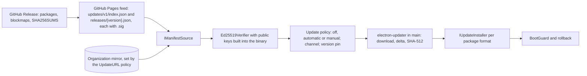

# Update architecture

> **Status:** approved design. Nothing described here is implemented or released yet. Structure and decisions are written in the present tense; runtime behavior is described as what the system will do.

Astela is designed to update itself on every supported platform without dialogs. A signed feed decides _what_ gets installed. Depending on the package format, electron-updater, the operating system's package manager or the IT department decides _how_ it gets installed. The decision records are ADR 0014 (update architecture with signed feed) and ADR 0015 (Linux package repositories); see the [decision record index](../adr/README.md).

## Overview

The update service belongs to the `updates` core module, which is always active (see [modules](modules.md)). It runs in the browser process; the [overview](overview.md) describes the process model.

### Chain of trust

Every link in the chain verifies the next one:

1. The Ed25519 signature of the index, which references the per-version manifests.
2. The Ed25519 signature of the manifest, which lists the SHA-512 hash of every file.
3. The SHA-512 hash of the downloaded file.
4. Authenticode on Windows (once releases are signed) or the code signature on macOS.

This chain also closes a known weakness of electron-updater 6: its own `latest.yml` metadata is not signed (as of October 2026).

## Signed feed

The feed is a deliberately small design inspired by The Update Framework (TUF). It is designed to protect against tampering, rollback and freeze attacks without additional infrastructure.

### Index

`updates/v1/index.json` lists the releases per channel. Besides the release entries, it carries three fields that protect clients against stale or replayed data:

| Field       | Meaning                                                                           |
| ----------- | --------------------------------------------------------------------------------- |
| `sequence`  | Monotonic counter. A client never accepts a value lower than the last one it saw. |
| `issuedAt`  | Time of signing.                                                                  |
| `expiresAt` | `issuedAt` plus 30 days.                                                          |

### Per-version manifests

Each version has a manifest, `releases/<version>.json`, with its own signature. It lists the artifacts per operating system, architecture and package format with file name, size, SHA-512 hash and blockmap. All file references are relative to `downloadBase`.

- The default `downloadBase` is `https://github.com/Secoolioo/astela/releases/download/v<version>/`.
- The `UpdateURL` policy points the client at a mirror instead. Because all references are relative, the signatures stay valid on the mirror.

### Signatures and keys

- The index and every manifest have a detached Ed25519 signature (`.sig`).
- Verification uses Node's built-in `crypto.verify` in the main process. There is no extra dependency, and a verification takes only microseconds.
- The binary embeds two public keys: the current key and its successor, so that keys can rotate without breaking installed clients.
- The private keys are stored only as GitHub environment secrets and in an encrypted offline backup kept by the repository owner. The rotation procedure will be documented with the release pipeline in the [maintainer workflow](../maintainers/WORKFLOW.md).

### Rejection rules

The client will reject a feed or manifest when:

- the signature is invalid,
- `sequence` is lower than the last value seen (rollback attack),
- `expiresAt` lies in the past (freeze attack),
- the update would be a downgrade and no policy allows it.

### Freshness and expiry

- The `pages.yml` workflow will re-sign the feed every week with a fresh `expiresAt`. Re-signing is a deployment, not a commit.
- An expired feed fails safe: nothing will be installed. The status "Feed out of date" will appear on the About page and on `app://diagnostics`, and the `freshness.yml` workflow will raise an alarm.
- GitHub pauses scheduled workflows in public repositories after 60 days without activity (as of October 2026). The maintainer workflow will document how to re-sign manually with `workflow_dispatch`.
- Mirrors must synchronize at least every 14 days.

### Hosting

- Binaries will be downloaded from GitHub Releases, which has no bandwidth limits (as of October 2026).
- The small feed lives on GitHub Pages.
- There is deliberately no second, immutable feed as a release asset. It would expire and would conflict with the feed on Pages.

## Update engine

Astela uses electron-updater 6.8.x as the installation engine. It runs in the main process with asynchronous I/O and a custom provider (`provider: 'custom'`):

- The `SignedFeedProvider` class will implement `getLatestVersion()` and `resolveFiles()` and will only return data taken from verified manifests.
- electron-updater will handle the download, the blockmap delta, the SHA-512 check and the installation for the formats it supports.

The update domain is built from these interfaces:

| Interface            | Responsibility                                                                            |
| -------------------- | ----------------------------------------------------------------------------------------- |
| `IUpdateService`     | `check()`, `download()`, `installOnQuit()` and the current `state`                        |
| `IManifestSource`    | `fetch(channel)` returns the signed manifest from GitHub Pages or a mirror                |
| `ISignatureVerifier` | `verify(bytes, signature)` checks Ed25519 signatures against the embedded keys            |
| `IUpdateInstaller`   | one strategy per package format: `canHandle(installType)`, `stage(artifact)`, `apply()`   |
| `BootGuard`          | `beginBoot()`, `markHealthy()` and `needsRollback()` for the first starts after an update |

The updater is a state machine: `idle → checking → downloading → staged → applying`.

## Install flow without dialogs

1. **Check:** 30–60 seconds after start, outside the startup path, then every 4 hours with ±30 minutes of jitter, and only while online.
2. **Download:** in the background, as a delta where the format allows it, with full verification.
3. **Notify:** a subtle dot on the menu button, a "Restart to update" menu entry and the status on the About page.
4. **Install:**
   - silently when the user quits normally, or
   - during idle time with a silent restart and session restore, when all of these hold: the update has been ready for at least 2 hours, the system has been idle for at least 30 minutes, and no audio or video is playing, no download is running, no WebRTC session is active and no private window is open.
   - If the system is shutting down, no installation starts. It runs at the next start instead, before the first window opens.
5. **Afterwards:** a non-modal "What's new in vX.Y" note with a link to the changelog.

## Channels

- There are two channels: `stable` and `beta`. The beta channel also receives stable versions.
- Switching from beta to stable never downgrades. The installation will stay on its version until a stable release overtakes it.
- Prereleases are versioned `X.Y.Z-beta.N`. The [maintainer workflow](../maintainers/WORKFLOW.md) defines the versioning rules, and the [roadmap](../roadmap.md) lists the milestones.

## Update policies

Organizations will control updates with these policies (see [enterprise](enterprise.md) and [settings, policies and themes](settings-policy-theme.md)):

| Policy                         | Effect                                                            |
| ------------------------------ | ----------------------------------------------------------------- |
| `UpdatePolicy`                 | `0` = off, `1` = automatic, `2` = manual only                     |
| `TargetChannel`                | Selects the channel.                                              |
| `TargetVersionPrefix`          | Selects the highest version in the index that matches the prefix. |
| `UpdateURL`                    | Points the client at a mirror.                                    |
| `AutoUpdateCheckPeriodMinutes` | Sets the check interval.                                          |

- `UpdateURL` is a sensitive policy. It will be honored only from machine-level policy (`HKLM` on Windows, forced preferences on macOS); otherwise `app://diagnostics` will show a warning.
- From M5, `RollbackToTargetVersion` and an update maintenance window follow.

### Organization mirror

`tools/mirror` is designed to mirror the feed and the packages one to one onto an internal HTTP server. The signatures stay valid because all URLs in the feed are relative. A mirror must synchronize at least every 14 days.

## Rollback

Updates must never destroy data. Every data migration takes a snapshot first, and an older version never opens a newer schema for writing (see [data](data.md)). On top of that, the `BootGuard` is designed to roll back a version that fails to start:

- **Before** an update is applied, the old, working version will write `boot-state.json` with `{ pending: vNew, previous: vOld, attempts: 0 }`. At that point the installation package of the running version will be available locally, either kept from the last update or downloaded and verified in the background beforehand.
- The first lines of the new version's main process will increment `attempts`. The new version counts as healthy once the shell is drawn, the profile database is open and it has run for 10 seconds without crashing.
- After 2 failed starts, the `BootGuard` will:
  1. restore the previous version silently from the local package, without network access,
  2. restore the data snapshots taken before the migration,
  3. block the failed version locally until a newer version appears.
- If a version fails to start **without** a preceding update, Astela will start in safe mode instead (manually in M1, automatically from M2).

**Documented limit:** the `BootGuard` cannot detect crashes that happen before the first JavaScript runs, for example with a damaged binary. The package smoke tests in every release run are the safeguard against this (see [testing](testing.md)).

## Strategy per package format

| Format                                                          | First install                                                    | Update                                                                  | Delta                                                            | Silent                    | Rollback                                                         |
| --------------------------------------------------------------- | ---------------------------------------------------------------- | ----------------------------------------------------------------------- | ---------------------------------------------------------------- | ------------------------- | ---------------------------------------------------------------- |
| **Windows NSIS** (per user, default for home users; x64, arm64) | `astela-windows-<arch>-setup.exe`, no administrator rights       | electron-updater `NsisUpdater` through the signed feed                  | yes (blockmap)                                                   | yes, without a UAC prompt | reinstall the previous version from its verified installer       |
| **Windows MSI** (per machine, organizations; x64; stable only)  | `msiexec /i … /qn` with `ALLUSERS=1` and a fixed `UpgradeCode`   | managed by IT; the in-app updater is off                                | no                                                               | yes, through IT tooling   | by IT, with `ALLOWDOWNGRADE`                                     |
| **macOS** (dmg to install, zip to update; x64 and arm64 apart)  | open the dmg and drag the app to Applications                    | electron-updater `MacUpdater` (Squirrel.Mac), signed and notarized      | yes (zip blockmap; the first update after a dmg install is full) | yes                       | APFS clone of the current bundle, swapped back by a helper       |
| **Linux AppImage** (x86_64, arm64)                              | download, mark as executable; static runtime, no libfuse2 needed | electron-updater `AppImageUpdater` replaces the file in place           | yes (blockmap)                                                   | yes                       | `.previous` copy, swapped back immediately                       |
| **Linux deb** (amd64, arm64)                                    | `apt install ./astela-linux-<arch>.deb`                          | Astela APT repository, together with system updates; in-app updater off | no                                                               | yes, with system updates  | `apt install astela=<previous>`; the repository keeps 2 versions |
| **Linux rpm** (x86_64, aarch64)                                 | `dnf install` with the downloaded `.rpm` file                    | Astela DNF repository, together with system updates                     | no                                                               | yes                       | `dnf downgrade`                                                  |

### Windows NSIS

- NSIS is the default for home users: a per-user installation without administrator rights, for x64 and arm64.
- Spike 1 measures whether `nsis` with a blockmap or `nsis-web` with `differentialPackage` produces smaller deltas. Delta sizes will be published only after that measurement.
- Unsigned installers trigger a SmartScreen warning on the **first installation**; updates run without it. The solution is Windows code signing (see [code signing](#code-signing)).

### Windows MSI

- The MSI is a native, per-machine package for organizations. It is built for x64 and for stable releases only, because MSI ignores prerelease identifiers.
- The installation type is recorded outside the policy keys, in `HKLM\SOFTWARE\Astela\Install` with `Type=msi`. Astela will detect this marker and turn the in-app updater off. IT distributes new MSI packages (Group Policy, Intune, SCCM) and controls updates with `UpdatePolicy`.
- electron-updater cannot install MSI packages (as of October 2026). An optional elevated update task running as `SYSTEM`, which installs verified MSI packages silently in the way Chrome and Edge update, is planned for M5.
- For arm64, electron-builder produces an MSI marked as x64 (as of October 2026). A dedicated WiX template follows in M5; until then, arm64 devices use NSIS.
- Silent installation flags, properties and Intune detection are described in [enterprise](enterprise.md).

### macOS

- x64 and arm64 get separate builds. The dmg is for the first installation; the zip is for updates.
- If the app runs from somewhere other than Applications (App Translocation), Astela will show a notice.
- Squirrel.Mac requires a stable code signature across versions.
- **With an Apple Developer ID**, the app is signed and notarized, and updates will install silently.
- **Without an Apple Developer ID**, there are two paths:
  1. A self-signed certificate with a stable designated requirement, so that Squirrel.Mac and the Keychain keep working across updates. A CI updater test on macOS will verify this path in an M1 spike. The first start then needs a one-time "Open Anyway" in System Settings (macOS Sequoia and later).
  2. If the spike fails: the update will be downloaded and verified in the background and installed with one click from the menu.
- **Recommendation:** the Apple Developer Program (99 USD per year, as of October 2026), for silent updates and notarization without the Gatekeeper hurdle.

### Linux AppImage

- The AppImage uses the static runtime, so libfuse2 is not required.
- Ubuntu 24.04 and later restrict unprivileged user namespaces, which disables the Chromium sandbox for AppImages (as of October 2026).
- Astela will never fall back to `--no-sandbox` silently. Instead, it will show a page with a one-click fix and the recommendation to use the deb or rpm package.
- The fix will use `pkexec` to install an AppArmor profile with `userns`. Because AppImages run from `/tmp/.mount_*`, the profile applies to `/tmp/.mount_*/astela`; this scope is documented for users.
- "Continue without sandbox" will be available only after explicit confirmation and will keep a permanent warning bar.
- The fix will be tested on a host runner with the user namespace restriction enabled, not in a container.

### Linux deb

- Astela will publish its own APT repository on GitHub Pages with a signed `InRelease` file and two suites: `stable` and `beta`.
- `postinst` will set up the repository source once (deb822 format with `Signed-By`). An environment variable allows opting out.
- Beta packages are versioned `0.1.0~beta.N`, so they sort correctly **before** `0.1.0`.
- Updates will arrive with the regular system updates. The in-app updater is turned off through `package-type`.
- electron-updater's deb updater asks for a password and does not verify a GPG signature (as of October 2026), so it is not used.
- The deb package will enable the sandbox through an AppArmor profile with `userns` (electron-builder template), with the SUID helper as a fallback.
- GitHub Pages has a 1 GB size limit and a soft limit of 100 GB of traffic per month (as of October 2026). The repository will therefore keep only the last 2 versions; if it outgrows that, the package pool moves to other hosting.

### Linux rpm

- Astela will publish its own DNF repository. The metadata will live on GitHub Pages; the packages will be served directly from GitHub Releases through `createrepo_c --baseurl` (`xml:base`, supported by dnf5).
- The metadata is signed (`repomd.xml.asc`) and the packages are signed with `rpmsign`.
- `%post` will create `/etc/yum.repos.d/astela.repo`. Betas use a separate `astela-beta.repo` with versions such as `0.1.0~beta.N`.
- Fedora and RHEL will be tested; openSUSE is supported on a best-effort basis.

### Upgrade order

The upgrade sequence `0.1.0-beta.1 → 0.1.0-beta.2 → 0.1.0` must work for NSIS, AppImage, deb (`0.1.0~beta.N`) and rpm. MSI packages are built only for stable versions. Automated tests will cover this order (see [testing](testing.md)).

## Versionless asset names

Release assets carry no version in their names, for example `astela-windows-x64-setup.exe`, `astela-macos-arm64.dmg` and `astela-linux-x86_64.AppImage`. They will be attached to versioned tags, so `releases/latest/download/<name>` stays a stable link. The blockmap delta will find the previous version through its tag.

## Early spikes

These spikes are scheduled for the start of M1, before the first walking skeleton release, because they carry the highest risk:

1. Custom provider with Ed25519 verification, with NSIS deltas on Windows and AppImage deltas on Linux; delta sizes are measured.
2. macOS with a self-signed certificate: Squirrel.Mac updates and Keychain stability.
3. AppImage sandbox fix on Ubuntu 24.04 and 26.04, on a host runner with the user namespace restriction enabled.
4. APT and DNF repositories: installation, upgrade and the version order `~beta.N` → stable. Containers test the package logic; the host tests the sandbox.
5. `node:sqlite` in the utility process with FTS5, WAL and `VACUUM INTO` on three operating systems and two architectures.
6. Inventory of the web platform APIs exposed by the embedded Chromium in the packaged build (see [security](security.md)).
7. Moving a tab between windows without a reload on Windows, macOS, X11 and Wayland.

## Code signing

Code signing is designed into the release workflows from the start. Signing steps will run only when the corresponding secrets exist; without certificates, everything will be built unsigned. Once the secrets are added, releases will be signed automatically.

### macOS signing

- Without an Apple ID, a self-signed code signing certificate valid for 10 years keeps the designated requirement stable. The repository owner generates it locally with `tools/owner/setup.sh`.
- Secrets for a Developer ID:
  - `CSC_LINK` and `CSC_KEY_PASSWORD`: the Developer ID Application certificate as `.p12`.
  - `APPLE_API_KEY`, `APPLE_API_KEY_ID` and `APPLE_API_ISSUER`: an App Store Connect team key.
- Switching from the self-signed certificate to a Developer ID breaks the designated requirement once. Existing installations will therefore receive that one update through a guided one-click step.
- Signing, notarization and stapling of the app and the dmg will run automatically.
- The Hardened Runtime uses minimal entitlements: JIT, camera and microphone, with usage descriptions.

### Windows signing

The release workflow is designed to support three options. The secret that is present selects the option:

1. **SignPath Foundation:** free for open-source projects after an application; the certificate is issued to "SignPath Foundation".
   - The repository owner approves each release with one click in the SignPath interface. The release job will wait up to 24 hours for that approval.
   - Betas may be published unsigned. Fully automatic signing, including within the 24-hour target for critical security fixes, requires option 2 or 3.
2. **Azure Artifact Signing:** about 9.99 USD per month; for individuals only in the USA and Canada, for organizations also in the EU (as of October 2026).
3. **An own OV certificate** in a cloud HSM.

With every option, `publisherName` is fixed, and the updater will check it fail-closed.

### Linux signing

- A GPG key signs the APT and DNF repositories.
- The Ed25519 update key signs the feed and `SHA256SUMS`.

See [security](security.md) for release integrity and the supply chain measures.

## Testing

The updater tests are designed to use a local test feed on `127.0.0.1` with two builds (`X-test.1` → `X-test.2`) and a test key. The mirror is set through the real policy mechanism, so production builds need no test backdoor. Negative cases cover a wrong signature, a hash mismatch, a downgrade and an expired manifest; a rollback case starts a build with a deliberate boot failure. Details are in [testing](testing.md).
