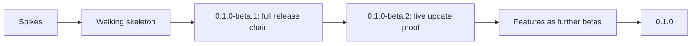

# Roadmap

> **Status:** this roadmap is a plan. Nothing has been released yet, and none of the features below is available today. Scope and order may change as the work progresses.

## Vision

Astela is a browser that feels like your own tool: it starts instantly, uses little memory and adapts to the way you work. Apart from that, it leaves you alone. It runs on Windows, macOS and Linux, is built on Chromium through Electron, and follows the [principles](architecture/principles.md) that guide every design decision.

## Priorities

Every feature has one priority, and each priority maps to a milestone:

| Priority | Milestone              | Meaning                                |
| -------- | ---------------------- | -------------------------------------- |
| P0       | M1 Foundation          | Required for the first stable release. |
| P1       | M2 Flow                | Planned for the second milestone.      |
| P2       | M3 Comfort             | Planned for the third milestone.       |
| P3       | M4 Ecosystem and later | Planned for M4 and later milestones.   |

The maintainers chose a set of features as the heart of Astela. They are marked **Team** in the [feature catalog](#feature-catalog) and are P0, at least in the basic form described in [M1 scope](#m1-scope-basic-form-of-the-team-features).

## Milestones

| Milestone       | Version                  | Scope                                                                          | Goal                                                           |
| --------------- | ------------------------ | ------------------------------------------------------------------------------ | -------------------------------------------------------------- |
| M1 Foundation   | `0.1.0-beta.N` → `0.1.0` | All P0 features, delivered in the [order described below](#m1-delivery-order). | A working, polished base browser that ships on every platform. |
| M2 Flow         | `0.2.0`                  | All P1 features.                                                               | The fastest way to work, with a built-in content blocker.      |
| M3 Comfort      | `0.3.0`                  | All P2 features.                                                               | An easy switch from other browsers.                            |
| M4 Ecosystem    | `0.4.0`                  | Extensions and the decision on a DRM-enabled variant.                          | Compatibility with the wider web ecosystem.                    |
| M5 Enterprise+  | `0.5.0`                  | Extended policies and an update service for MSI installations.                 | Rollout in organizations.                                      |
| M6 Sync and 1.0 | `1.0.0`                  | Sync, stabilization and complete documentation.                                | Stable API and data formats, ready for long-term support.      |

## M1 scope: basic form of the team features

M1 delivers exactly this basic form of each team feature, and nothing more. Everything in the last column comes later.

| Feature           | Basic form in M1                                                                                                                                                                             | Later                                                                               |
| ----------------- | -------------------------------------------------------------------------------------------------------------------------------------------------------------------------------------------- | ----------------------------------------------------------------------------------- |
| Workspaces        | Create, rename and delete; icon from a built-in set, color and theme; switcher and shortcuts; optional isolated partition.                                                                   | Workspace rules (URL to workspace), own search engine and start page per workspace. |
| Themes            | Light, dark and system; accent presets plus a free accent color; 5 built-in themes; import and export; an editor for the token list (colors, radius) with live preview and contrast warning. | Gradients, background images, a local theme gallery.                                |
| Density and fonts | 3 density levels; UI font and size; default web fonts.                                                                                                                                       | No expansion planned.                                                               |
| Toolbar           | Show, hide and reorder items in a list view (drag within the list); reset.                                                                                                                   | Dragging directly in the toolbar, multiple toolbars.                                |
| New tab page      | Background (color or image), manual tiles, search box and clock on or off.                                                                                                                   | Widgets.                                                                            |
| Search engines    | List, default engine, keywords, adding custom engines.                                                                                                                                       | OpenSearch discovery.                                                               |
| Shortcuts         | List of all commands, recording a key, showing conflicts, reset.                                                                                                                             | Chords.                                                                             |
| Settings          | Generated from the schema; search in every shipped language; export and import; policy lock.                                                                                                 | No expansion planned.                                                               |
| Tab bar           | 4 positions; collapsible when vertical; drag and drop between windows and workspaces; tear-off; groups (name, color, collapsible); pinned tabs.                                              | Tab stacks, tree view.                                                              |

## Feature catalog

The module column names the feature module that is designed to own the feature. See the [module system](architecture/modules.md) for how modules work.

### P0: M1 Foundation

| Area          | Feature                                                                                                                                                                                                                                                                                   | Modules                                                             |
| ------------- | ----------------------------------------------------------------------------------------------------------------------------------------------------------------------------------------------------------------------------------------------------------------------------------------- | ------------------------------------------------------------------- |
| Core          | Windows, tabs, navigation, omnibox (URL or search, suggestions from history, bookmarks and open tabs), find in page, per-site zoom, context menus, DevTools, printing through the system dialog, PDF viewer, full screen.                                                                 | `tabs`, `navigation`, `omnibox`                                     |
| Core          | Downloads (list, panel, open folder), history (list, search, delete), bookmarks (star, bar, manager), private window.                                                                                                                                                                     | `downloads`, `history`, `bookmarks`, `private-window`               |
| Core          | Session restore: lazy, with crash recovery, and exact after an update.                                                                                                                                                                                                                    | `session`                                                           |
| Core          | Site permissions: prompt in the overlay, a per-site list to review and revoke decisions. Enforcement (default deny) lives in the kernel and cannot be switched off.                                                                                                                       | `permissions` (UI only)                                             |
| Security      | HTTPS-First: upgrade to HTTPS, an interstitial to continue over HTTP, exceptions per host; DNS over HTTPS setting.                                                                                                                                                                        | `https-first`                                                       |
| Team          | Workspaces: name, icon, color and theme; quick switching through a switcher, shortcuts (`Ctrl/Cmd+Alt+1` to `9`) and a command; optional isolated session.                                                                                                                                | `workspaces`                                                        |
| Team          | Layout presets: "Classic", "Vertical left", "Vertical right", "Bottom" and "Compact"; chosen on first start (non-modal, on the new tab page) and in settings; freely adjustable afterwards.                                                                                               | `layout`                                                            |
| Team          | Themes: light, dark and system; accent colors; theme files; a theme editor with live preview; import and export.                                                                                                                                                                          | `themes`, `theme-editor`                                            |
| Team          | Customization: UI density, fonts (UI and web defaults), a freely arrangeable toolbar, a customizable new tab page, search engines with keywords, custom keyboard shortcuts, schema-based settings that are searchable and exportable.                                                     | `toolbar`, `newtab`, `search-engines`, `keybindings`, `settings-ui` |
| Team          | Tab bar on the top, bottom, left or right (collapsible width when vertical), drag and drop between windows and workspaces, tear-off, tab groups, pinned tabs.                                                                                                                             | `tabstrip`, `tab-groups`                                            |
| Enterprise    | Policy engine for all three operating systems with about 22 policies; generated ADMX/ADML, mobileconfig and Linux JSON; per-machine silent MSI; DNS over HTTPS; proxy and PAC; auth server allowlist (Kerberos and NTLM); diagnostics page; local logs; manual safe mode; admin guide v1. | `policy`, `diagnostics`, `safe-mode`                                |
| Updates       | The complete update chain: signed feed, background download with delta updates, installation per package format, rollback. See [updates](architecture/updates.md).                                                                                                                        | `updates`                                                           |
| Cross-cutting | Internationalization: the UI ships in two languages, follows the system language and can be switched, and a new language needs only JSON files; accessibility basics (keyboard, screen readers, forced colors, reduced motion); no telemetry.                                             | `i18n`                                                              |

### P1: M2 Flow

| Area       | Feature                                                                                                                                                                                                                                                                               | Modules             |
| ---------- | ------------------------------------------------------------------------------------------------------------------------------------------------------------------------------------------------------------------------------------------------------------------------------------- | ------------------- |
| Security   | Strict HTTPS-Only mode, blocking third-party cookies, Global Privacy Control, removal of tracking parameters.                                                                                                                                                                         | `privacy`           |
| Enterprise | Jamf JSON schema, `ManagedBookmarks`, `AuthNegotiateDelegateAllowlist`, automatic safe mode after failed starts, a dictionary mirror. Until the mirror exists, spell checking is off on Windows and Linux so that no requests go to Google CDNs; macOS uses the system spell checker. | No dedicated module |
| Flow       | Command palette (commands, tabs, history, bookmarks, settings), tab search.                                                                                                                                                                                                           | `command-palette`   |
| Flow       | Split view with 2 to 4 panes, a layout tree, and drag and drop.                                                                                                                                                                                                                       | `split-view`        |
| Flow       | Tab sleep: on inactivity, under memory pressure or manually, with exceptions and an indicator.                                                                                                                                                                                        | `tab-sleep`         |
| Privacy    | Ad and tracker blocker (network and cosmetic filtering, per-site toggle, signed filter feeds); malware and phishing lists with an interstitial.                                                                                                                                       | `content-blocker`   |

### P2: M3 Comfort

| Area    | Feature                                                                                                                  | Modules                                       |
| ------- | ------------------------------------------------------------------------------------------------------------------------ | --------------------------------------------- |
| Comfort | Reader view, picture-in-picture button (video and Document Picture-in-Picture), mouse gestures, sidebar with web panels. | `reader`, `pip`, `gestures`, `sidebar-panels` |
| Comfort | Import of bookmarks, history and password CSV files from Chrome, Edge, Brave, Vivaldi, Opera, Firefox and Safari.        | `import`                                      |
| Comfort | Password manager with OS key storage, basic autofill, and CSV import and export.                                         | `passwords`                                   |

### P3: M4 and later

| Area        | Feature                                                                                                                                         | Modules             |
| ----------- | ----------------------------------------------------------------------------------------------------------------------------------------------- | ------------------- |
| Ecosystem   | Extensions: a Manifest V3 subset with a curated compatibility list.                                                                             | `extensions`        |
| Media       | Evaluation of a DRM-enabled variant (Widevine).                                                                                                 | Build flavor        |
| Enterprise+ | More than 50 policies, extension policies, an optional update service for MSI installations, a certificate UI, a VPAT and accessibility report. | No dedicated module |
| Sync        | End-to-end encrypted sync of bookmarks, settings and tabs, self-hostable.                                                                       | `sync`              |

## M1 delivery order

M1 is designed to reach users early and to prove the whole delivery chain before the features arrive. Work lands in small pull requests of roughly 400 changed lines, each with green checks.

### 1. Spikes

The riskiest technical questions are answered first, on branches. Their results flow into the [architecture decision records](adr/README.md); only clean code is merged.

1. A custom update provider with Ed25519 verification and delta updates for NSIS on Windows and AppImage on Linux, with measured delta sizes.
2. macOS updates with a self-signed certificate: Squirrel updates and keychain stability across updates.
3. The Chromium sandbox for AppImage on Ubuntu 24.04 and 26.04, which restrict unprivileged user namespaces, tested on a host runner with that restriction enabled.
4. APT and DNF repositories: installation, upgrade, and the version order from `~beta.N` to the stable release.
5. `node:sqlite` in a utility process with FTS5, WAL and `VACUUM INTO` on 3 operating systems and 2 architectures.
6. An inventory of the web platform APIs that the packaged build exposes.
7. Moving a tab between windows without a reload on Windows, macOS, X11 and Wayland.

### 2. Walking skeleton: `0.1.0-beta.1`

The first beta is a minimal browser (windows, tabs, omnibox and the security baseline) that already runs through the **complete** package, update, release and website chain. It is built in this order:

| Step | Increment          | Content                                                                                                                                                                           |
| ---- | ------------------ | --------------------------------------------------------------------------------------------------------------------------------------------------------------------------------- |
| 1    | Kernel             | Dependency injection container, `ModuleHost`, event bus, lifecycle, logging.                                                                                                      |
| 2    | Core domain        | Settings and policy domain; policy providers that load synchronously before the app is ready; code generation for JSON Schema, ADMX/ADML, mobileconfig, Linux JSON and docs.      |
| 3    | Platform           | `BaseWindow` and `WebContentsView`, the `app://` scheme, `IpcRouter`, the security baseline (fuses, CSP, permission and navigation guards), `BootGuard`, safe mode, logs.         |
| 4    | Shell              | A minimal shell (tabs on top, toolbar, omnibox), the overlay, and the internationalization basics.                                                                                |
| 5    | Packaging          | Every package format and architecture, package smoke tests, the end-to-end test skeleton on 3 operating systems, and the performance harness with a bare Electron reference.      |
| 6    | Updates            | Signed feed, custom provider, an installer per package format, rollback, the migration framework, updater tests.                                                                  |
| 7    | Linux repositories | APT and DNF repositories including beta suites, with upgrade order tests.                                                                                                         |
| 8    | Release pipeline   | Release and website workflows; a website skeleton with landing page, download page built from release data, docs, API reference and changelog; screenshot job; live verification. |
| 9    | `0.1.0-beta.1`     | The first beta release, meeting the complete Definition of Done.                                                                                                                  |

### 3. Live update proof: `0.1.0-beta.2`

The second beta exists to prove a real update on installed systems: NSIS on Windows, AppImage on Linux, macOS (depending on the code signing status), and upgrades through the APT and DNF repositories. The updater job will additionally prove an update from an installed `0.1.0-beta.1` through the live feed.

### 4. Features as further betas

The P0 features follow in about 20 small pull requests. Every few pull requests, a new `0.1.0-beta.N` will be released, each meeting the complete Definition of Done:

- **Tabs:** the full tab model (4 positions, collapsible vertical bar, groups, pinned tabs), drag and drop across windows and workspaces, tear-off.
- **Workspaces and session:** workspaces including isolated partitions; lazy session restore and crash recovery.
- **Data:** the data service, history, bookmarks, downloads, private window.
- **Appearance:** the [design system](architecture/design-system.md) (tokens, density, fonts) and layout presets; the theme engine, built-in themes, the theme editor, import and export.
- **Settings and customization:** the settings page (search, export and import, policy lock); toolbar editor, new tab page, search engines, shortcut editor.
- **Security and enterprise:** permissions UI, HTTPS-First, DNS over HTTPS; enterprise policies, proxy and authentication, MSI properties, the diagnostics page and admin guide v1. See [enterprise](architecture/enterprise.md).
- **Completion:** full accessibility and internationalization coverage.

### 5. Release `0.1.0`

When every P0 feature meets its acceptance criteria, `0.1.0` is released on the stable channel. The upgrade path `0.1.0-beta.1` → `0.1.0-beta.2` → `0.1.0` must work for NSIS, AppImage, deb and rpm; deb and rpm packages encode betas as `0.1.0~beta.N` so that they sort before the final release. MSI packages are built for stable releases only, so `0.1.0` will be the first release with an MSI package.

## Related documents

- [Principles](architecture/principles.md)
- [Architecture overview](architecture/overview.md)
- [Performance](architecture/performance.md)
- [Testing](architecture/testing.md)
- [Architecture decision records](adr/README.md)
